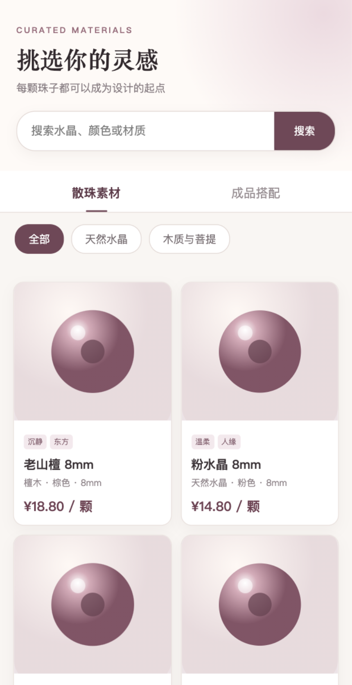
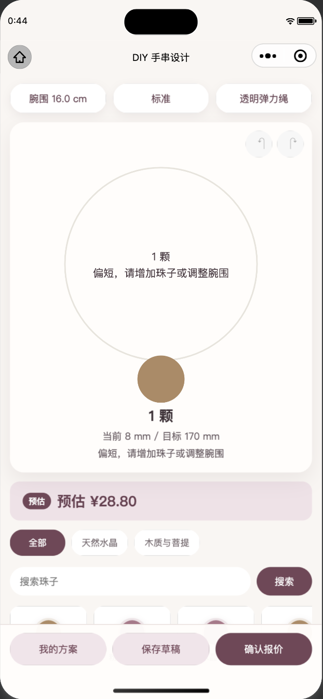
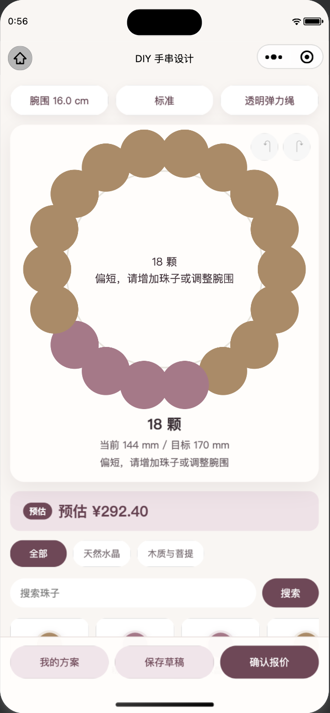
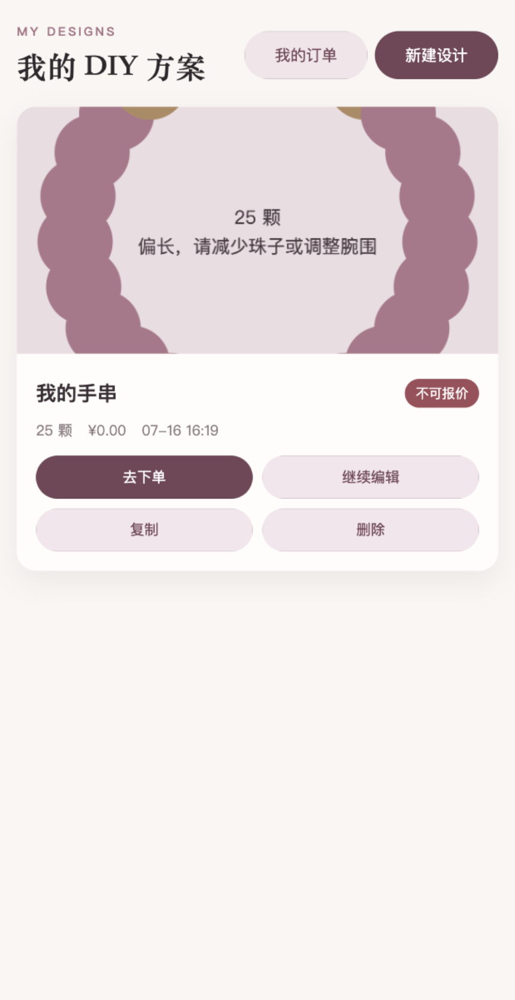
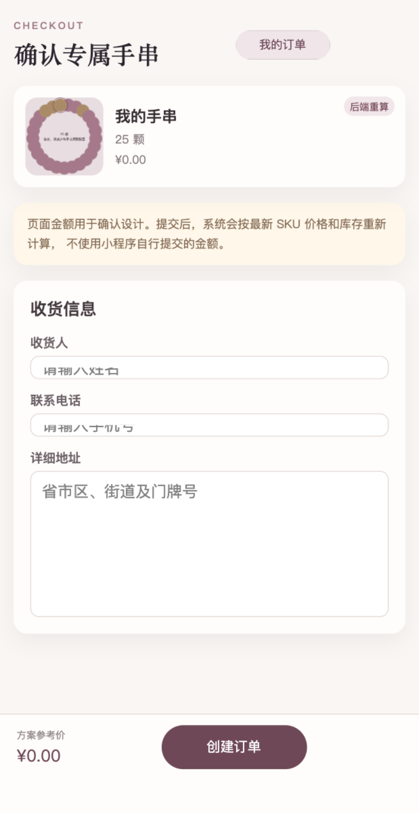
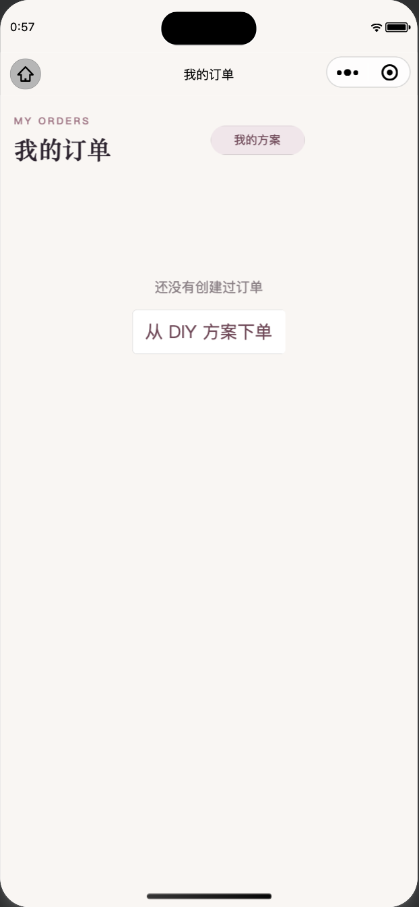

# DIY 手串小程序产品交互与用户体验审查

审查日期：2026-07-17
审查范围：常规商品购买、DIY 手串定制、星座与属相智能推荐、购物结算、订单状态、无障碍风险
审查方式：项目源码与文档阅读、当前微信开发者工具真实页面操作、只读本地接口验证、截图检查
代码修改：无业务代码修改

## 一、执行结论

当前产品更接近“DIY 手串设计与模拟下单原型”，尚未形成三条完整商业闭环。

- DIY 编辑器已有添加、删除、拖动排序、撤销重做、实时估价、服务端报价和方案保存，完成度最高。
- 常规购买缺少规格、数量、购物车和真实支付，用户无法按常规电商路径购买。
- 星座、属相智能推荐当前返回 `NOT_CONFIGURED`，运行态在入口后立即阻断。
- 当前公开目录只有 4 个散珠 SKU 和 1 个套餐，所有 `coverUrl` 均为空；而 AI 候选查询强制要求有效图片，因此即使配置模型，当前候选集也很可能为空。
- 不可报价、金额为 ¥0.00 的方案仍能进入确认订单页，错误暴露过晚。

优先级统计：P0 4 项，P1 16 项，P2 9 项，P3 1 项。

## 二、技术栈、启动方式与页面路由

### 技术栈

- 后端：Java 17、Spring Boot 3.2.12、MyBatis-Plus、MySQL、Flyway、JWT、本地文件存储。
- 管理后台：Vue 3、TypeScript、Vite、pnpm。
- 小程序：原生微信小程序，TypeScript、WXML、WXSS、Canvas 2D。
- 默认地址：后端 8081，管理后台 5173。

### 启动方式

1. 启动 Docker 基础设施。
2. 在 backend 目录通过 Maven 启动 Spring Boot。
3. 在 admin-web 目录通过 pnpm 启动 Vite。
4. 微信开发者工具导入 miniprogram 目录。

### 当前小程序路由

1. 首页：pages/home/index
2. 智能推荐：pages/recommendation/index
3. 商品目录：pages/catalog/index
4. 商品详情：pages/catalog/detail
5. DIY 编辑器：pages/diy/editor
6. 我的方案：pages/diy/schemes
7. 确认订单：pages/order/confirm
8. 订单列表：pages/order/list
9. 订单详情：pages/order/detail

当前不存在购物车路由。

## 三、截图证据

### 1. 首页

首页的常规选珠、直接 DIY、我的方案入口清楚。核心 AI 功能位于首屏下方，并使用“AI 灵感咨询”命名，没有直接表达星座、属相和可购买商品之间的关系。

### 2. 智能推荐阻断状态

当前接口状态为 NOT_CONFIGURED。用户只能重新检查或返回首页，无法进入信息填写、模型生成和推荐结果。

### 3. 商品目录与详情

商品目录有搜索、分类、散珠和套餐，但商品使用通用占位珠图。详情页仅提供“开始 DIY”，没有规格、库存、数量、加入购物车或直接购买。

### 4. DIY 编辑器

Canvas 预览、尺寸状态和实时估价清楚。主要问题是画布占据大部分首屏，选珠托盘位于底部，拖动排序、选中和替换等操作缺少引导。

### 5. 方案、结算与订单

不可报价、¥0.00 的方案仍显示“去下单”，并能进入确认订单页。订单列表当前为空，订单详情和模拟支付只能通过静态实现审查。

## 四、当前完整用户流程

### 1. 常规商品购买

| 步骤 | 当前状态 | 健康度 |
| --- | --- | --- |
| 首页进入商品 | “开始选珠”入口清楚 | 可用 |
| 商品分类与搜索 | 支持分类、关键词、散珠和套餐 | 可用 |
| 商品详情 | 只有基础材料、尺寸和单颗价格 | 部分可用 |
| 选择规格和数量 | 不存在 | 阻断 |
| 加入购物车 | 不存在购物车页面与服务 | 阻断 |
| 确认订单 | 只能从 DIY 方案进入 | 部分可用 |
| 提交订单 | 页面存在，本次未实际提交 | 未实测 |
| 支付 | 只有模拟支付 | 阻断生产使用 |
| 订单状态 | 页面实现存在，当前账号无订单 | 部分可用 |

实际路径为：首页 → 商品目录 → 商品详情 → DIY 编辑器。

### 2. DIY 定制

| 步骤 | 当前状态 | 健康度 |
| --- | --- | --- |
| 首页进入 DIY | 首页、商品和套餐均可进入 | 可用 |
| 空白或模板 | 空白与套餐可用，没有独立入口选择页 | 部分可用 |
| 选择珠子 | 分类、搜索、托盘存在 | 部分可用 |
| 添加和删除 | 已实现 | 可用 |
| 调整顺序 | Canvas 拖动已实现，缺少提示 | 部分可用 |
| 选择配饰 | 没有配饰模型和入口 | 阻断 |
| 手围、松紧和绳材 | 已实现 | 可用 |
| 实时预览 | 已实现 | 可用 |
| 实时价格 | 本地预估和服务端报价均存在 | 可用 |
| 保存方案 | 已实现 | 可用 |
| 加入购物车 | 不存在 | 阻断 |
| 下单 | 必须离开编辑器进入我的方案 | 部分可用 |

### 3. 星座与属相智能推荐

| 步骤 | 当前状态 | 健康度 |
| --- | --- | --- |
| 首页入口 | 名称模糊且位于首屏下方 | 部分可用 |
| 服务状态 | 当前 NOT_CONFIGURED | 阻断 |
| 信息填写 | 代码存在，运行态不可进入 | 静态审查 |
| 星座和属相 | 自由文本，不是选择器 | 部分实现 |
| 用户信息确认 | 没有独立确认步骤 | 缺失 |
| 模型生成 | 当前不可调用 | 阻断 |
| 等待与失败恢复 | 无取消、离开恢复和针对性重试 | 部分实现 |
| 推荐结果 | 只支持单方案 | 静态审查 |
| 推荐理由 | 每个 SKU 有自由文本理由 | 部分实现 |
| 库存匹配 | 后端有复核，但当前候选数据存在断层 | 阻断风险 |
| 查看珠子详情 | 结果页没有详情入口 | 缺失 |
| 替换、调数、排序 | 结果页不支持，只能进入 DIY | 缺失 |
| 进入 DIY | 一次性 handoff 已实现 | 部分实现 |
| 保存方案 | 进入 DIY 后可保存 | 间接可用 |
| 加入购物车 | 不存在 | 阻断 |
| 下单 | 需经方案列表，真实支付不存在 | 阻断闭环 |

## 五、常规购物流程问题

| 编号 | 优先级 | 页面与操作 | 原因与影响 | 建议 |
| --- | --- | --- | --- | --- |
| R1 | P0 | 商品详情 → 规格 → 购物车 | 详情只有开始 DIY，应用无购物车。普通购买者无法完成购买。 | 增加规格、数量、库存、加入购物车和立即购买。 |
| R2 | P1 | 目录和详情浏览 | 商品主图为空，全部显示通用珠图，无法判断材质、颜色和质感。 | 商品上架前强制上传主图、细节图和尺寸参照图。 |
| R3 | P1 | 不可报价方案 → 去下单 | ¥0、不可报价方案仍可进入结算，问题直到提交才暴露。 | 禁用去下单，展示失效原因和一键修复。 |
| R4 | P0 | 创建订单 → 支付 | 只有模拟支付，无法形成真实商业闭环。 | 接入微信支付、回调、幂等、退款和异常对账。 |
| R5 | P2 | 确认订单 → 收货信息 | 无地址簿、省市区选择和手机号格式校验。 | 增加微信地址导入、地址簿、逐字段错误提示。 |
| R6 | P2 | 订单详情 | 缺少物流、客服、退款售后、再次购买和复制方案。 | 增加完整履约与售后入口。 |

## 六、DIY 定制流程问题

| 编号 | 优先级 | 页面与操作 | 原因与影响 | 建议 |
| --- | --- | --- | --- | --- |
| D1 | P2 | 首页 → DIY | 用户直接进入复杂编辑器，没有空白、模板、历史、AI 四种入口。 | 新增 DIY 起始页。 |
| D2 | P1 | 编辑器 → 配饰 | 没有隔珠、吊坠、主珠等配饰模型。 | 建立配饰 SKU、库存、计价、兼容规则和 Canvas 渲染。 |
| D3 | P1 | 分类或搜索 | 搜索结果合并进旧目录，筛选不能真正缩小托盘。 | 分类和搜索时替换可见结果。 |
| D4 | P1 | 选中珠子 → 替换 | 替换会自动选择第一颗不同 SKU，用户无法选择。 | 使用替换抽屉，展示相似 SKU、价格差和库存。 |
| D5 | P1 | 选珠托盘 | 只显示色块和名称，没有图片、单价、尺寸、材质和库存。 | 丰富托盘卡片信息。 |
| D6 | P2 | Canvas 选中与拖动 | 操作依赖隐藏手势，撤销重做触控面积偏小。 | 增加首次引导、排列列表和更大触控区。 |
| D7 | P2 | 设置手围 | 只有 5mm 递增选择，无测量指南和松紧差异说明。 | 增加测量图解、直接输入和尺寸解释。 |
| D8 | P1 | 报价 → 保存 → 下单 | 报价和保存相互独立，必须离开编辑器才能下单。 | 改成保存并加入购物车，提交前自动服务端校价。 |
| D9 | P1 | 恢复旧方案 | 恢复快照时可能使用 0 单价，出现 ¥0 和不可报价状态。 | 恢复时拉取当前 SKU，失效项阻止结算并提供替换。 |
| D10 | P2 | 离开和恢复草稿 | 本地只有一个草稿，没有自动保存时间和版本提示。 | 支持多草稿、服务器草稿和版本冲突处理。 |

## 七、星座与属相智能推荐问题

| 编号 | 优先级 | 页面与操作 | 原因与影响 | 建议 |
| --- | --- | --- | --- | --- |
| A1 | P0 | 首页 → 智能推荐 | 当前服务 NOT_CONFIGURED，核心功能完全不可用。 | 增加上线 readiness 门禁和可用性监控。 |
| A2 | P0 | 生成 → 候选 SKU | 所有公开 SKU 主图为空，候选查询强制要求有效图片，候选很可能为零。 | 修复商品图片；readiness 同时检查候选数。 |
| A3 | P1 | 首页入口 | AI 灵感咨询没有说明星座、属相、耗时、费用、可编辑和隐私。 | 改为“星座·属相智能推荐手串”，补充核心说明。 |
| A4 | P1 | 填写星座和生肖 | 使用自由文本；核心字段可全空，但预算和手围必填。 | 使用选择器，并要求满足生日或星座、年份或生肖之一。 |
| A5 | P1 | 生日自动推导 | 生肖按公历年份计算，且手动值与生日冲突时静默覆盖。 | 明确农历口径，冲突时要求用户确认。 |
| A6 | P1 | 填写偏好 | 缺少不喜欢材质、结构化风格、佩戴目的和预算弹性。 | 使用分组多选，禁用材质作为后端硬约束。 |
| A7 | P1 | 确认并提交 | 没有完整说明发送给模型的数据、服务商、保存期限和删除方式。 | 提交前展示最小化数据摘要和隐私同意。 |
| A8 | P1 | 生成等待 | 无取消、阶段进度、离开后恢复和幂等重试。 | 改为可恢复的异步任务。 |
| A9 | P1 | 推荐结果 | 只返回一套，缺少完整预览、库存、风格、场景和预算差额。 | 返回三套差异明确且已校验的方案。 |
| A10 | P1 | 结果修改 | 只能一键进入 DIY，没有局部替换、换色和调预算。 | 增加快速编辑、锁定部分结果和局部重生成。 |
| A11 | P1 | 结果 → DIY | handoff 丢失方案名、推荐理由、预算和依据。 | 保存推荐方案 ID、版本、依据和输入摘要。 |
| A12 | P1 | 失败恢复 | 超时、低预算、无库存等都可能显示通用不可用。 | 按错误原因提供提高预算、换颜色或重试等行动。 |
| A13 | P2 | 推荐理由 | 有免责声明和敏感文案拦截，但依据仍是自由文本。 | 按星座、生肖、用户偏好、预算库存分组解释。 |
| A14 | P2 | 历史记录 | 无历史、收藏、复制、再次购买和删除；离开会清空结果。 | 增加推荐历史与可删除记录。 |

## 八、整体交互与无障碍风险

| 编号 | 优先级 | 问题 | 建议 |
| --- | --- | --- | --- |
| X1 | P2 | 多个卡片和标签使用 view 点击，缺少按钮语义；部分文字过小；活动状态依赖颜色。 | 使用按钮或导航语义，扩大触控区，增加文字或图标状态，并做读屏测试。 |
| X2 | P3 | “后端重算”“权威报价”等术语偏开发视角。 | 改为“价格已校验”“提交时按最新库存和价格确认”。 |

截图不能证明读屏、动态字体、键盘焦点和完整无障碍合规，仍需真机测试。

## 九、推荐的新用户流程

### 常规购买

首页 → 商品目录 → 商品详情 → 选择规格与数量 → 加入购物车或立即购买 → 购物车校验 → 地址 → 确认订单 → 微信支付 → 订单与物流 → 售后或再次购买。

### DIY

首页进入 DIY → 选择空白、模板、历史或 AI 方案 → 手围指南 → 选珠与配饰 → 添加、删除、替换、排序 → 实时预览和估价 → 服务端校价 → 保存并加入购物车 → 结算 → 支付。

### 智能推荐

首页“星座·属相智能推荐” → 功能说明 → 基础主题 → 风格颜色与禁用材质 → 手围和信息确认 → 同意提交最小化资料 → 可恢复生成进度 → 三套已校验方案 → 查看依据与商品 → 快速替换或调预算 → DIY 深度修改 → 保存 → 购物车 → 再次校验 → 下单支付。

## 十、推荐页面信息架构

- 首页
  - 星座与属相智能推荐
  - 商品目录
  - DIY 入口
  - 我的方案
- 智能推荐
  - 功能说明
  - 分步资料填写
  - 信息确认与隐私告知
  - 生成进度
  - 多方案结果
  - 方案详情与快速编辑
  - 推荐历史
- 商品
  - 分类与搜索
  - 商品详情
  - 收藏
- DIY
  - 空白设计
  - 模板
  - 编辑器
  - 草稿与方案
- 购物车
- 结算与支付
- 我的
  - 订单
  - 地址
  - 推荐历史
  - 收藏
  - 隐私与数据删除

## 十一、推荐结果页字段

- 方案 ID、版本、名称、方案类型。
- 完整手串预览图、风格、主色和佩戴场景。
- 用户输入摘要。
- 星座主题、生肖文化、个人偏好、预算库存四类依据。
- SKU ID、名称、材质、颜色、直径、图片、数量、单价、小计和实时库存。
- 配饰、绳材、排列顺序、手围、目标长度和松紧状态。
- 珠子费、配饰费、制作费、绳材费、运费、总价和预算差额。
- 最后库存与价格校验时间。
- 文化娱乐参考免责声明。
- 查看详情、替换、调数量、调顺序、换一套、进入 DIY、保存和加入购物车操作。

## 十二、异常与边界场景

### 输入

- 星座空、生肖空、两者都空、只填一项。
- 日期格式错误、未来生日、闰日、农历新年前后。
- 生日与手选星座生肖冲突。
- 不支持名称、错别字、超长输入。

### 偏好与尺寸

- 极低预算、颜色无库存、所有材质被排除。
- 用户要求不存在的珠子。
- 禁用材质与推荐冲突。
- 手围超范围或无法满足目标长度。

### 模型服务

- 未配置、暂停、鉴权失败、模型不存在、限流、超时、断网。
- 重复提交、取消生成、离开页面、进程被关闭。
- 空结果、格式错误、重复字段、未知 SKU、理由缺失、违规文案。

### 商品与库存

- 生成后 SKU 下架、库存不足、价格变化、图片缺失。
- 配饰或绳材失效。
- 替代 SKU 也无库存。

### 编辑、购物与支付

- 替换后超预算或长度不合适。
- 草稿版本冲突和历史 SKU 不存在。
- 购物车过期、重复创建订单、库存预占失败。
- 支付取消、失败、重复回调、超时关单和退款。

### 隐私与历史

- 用户拒绝填写生日或拒绝模型提交。
- 删除推荐、保留期限到期、游客身份丢失和跨设备恢复。

## 十三、大模型与商品数据库衔接方案

当前值得保留的实现：模型只能选择候选 SKU；候选要求在售和有库存；返回采用严格 JSON；后端会重新验证 SKU、数量、库存、预算、长度和价格；最终价格不信任模型；已有文化娱乐免责声明和高风险文案拦截。

推荐链路：

1. 服务端标准化用户输入，生日仅用于服务端推导。
2. 从商品数据库查询真实在售、有库存且可用于 DIY 的 SKU。
3. 规则层先过滤禁用材质、尺寸、预算、配饰兼容性。
4. 只把候选 SKU 和最小化后的资料发送给模型。
5. 模型生成三套结构化组合与理由。
6. 严格解析，格式错误最多修复重试一次。
7. 后端重新验证库存、数量、长度、价格、预算和文案。
8. 返回方案版本、报价指纹、校验时间和替代 SKU。
9. 编辑、保存、加入购物车和结算时再次校验。
10. 加入购物车后短期预占库存，下单时锁定 BOM 和价格。

关键要求：AI 状态接口同时检查模型配置、候选数量、绳材、计价规则和服务健康；商品图片缺失应在上架时解决，不能在推荐时静默清空候选；禁用材质、预算和尺寸必须由确定性规则保证。

## 十四、需要新增或修改的页面

### 新增

- DIY 起始页。
- 购物车。
- AI 功能介绍页或介绍区。
- 分步资料填写页。
- 生成进度页。
- 多方案推荐结果页。
- 推荐历史页。
- 地址簿。
- 隐私与数据管理页。

### 修改

- 首页。
- 商品详情。
- DIY 编辑器。
- 我的方案。
- 确认订单。
- 订单详情。

## 十五、需要新增或修改的组件

- 星座选择器、生肖选择器、生日冲突确认。
- 偏好标签组、分步进度、生成状态。
- 推荐方案卡片、推荐依据、库存状态。
- 替换珠子抽屉、珠子详情、配饰选择。
- 价格明细、草稿保存状态、尺寸指南。
- 隐私同意面板、固定购买操作栏。

## 十六、需要新增或修改的接口

- AI readiness：配置、候选数、模型健康、计价和绳材准备状态。
- 异步推荐任务：创建、查询、取消、恢复和幂等键。
- 局部重生成：锁定 SKU、换主珠、换配色和调预算。
- 推荐方案校验：进入 DIY、保存、购物车和结算前复核。
- 推荐历史：查询、收藏、复制、删除和再次购买。
- 商品替代：按尺寸、材质、颜色、价格返回可售替代 SKU。
- 配饰目录：库存、价格和兼容规则。
- 购物车：新增、修改、删除、失效检查和重新校价。
- 结算：订单预览、地址、库存预占和幂等创建。
- 支付售后：微信支付、回调、退款、物流和售后。

## 十七、实施优先级

1. P0：配置并验证真实 AI 调用，修复零候选数据，上线 readiness。
2. P0：补购物车、微信支付和退款基础闭环。
3. P1：重做 AI 输入、三方案结果、快速编辑和状态恢复。
4. P1：禁止无效方案下单，修复 DIY 搜索和替换。
5. P1：补商品真实图片、库存、规格和配饰。
6. P2：推荐历史、地址簿、尺寸指南、无障碍和售后体验。

## 十八、审查证据限制

- 智能推荐运行态被 NOT_CONFIGURED 阻断，真实填写、等待和结果页没有运行截图，相关结论来自静态实现和只读接口。
- 当前订单列表为空，本次没有创建订单或执行模拟支付，订单详情和支付主要基于静态实现检查。
- 截图无法验证读屏、动态字体、焦点顺序、弱网和真机性能。
- 原始及未采用截图保存在 screenshots/raw-and-rejected，正式证据保存在 screenshots/accepted-evidence。
